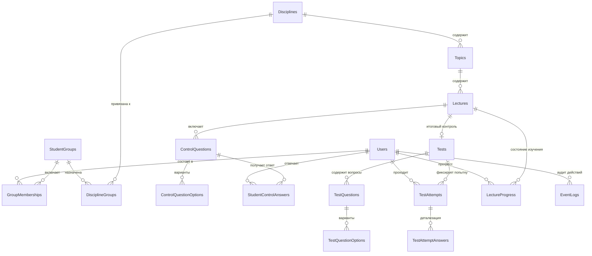

# ИНДИВИДУАЛЬНОЕ ПРАКТИЧЕСКОЕ ЗАДАНИЕ
## Тема: Разработка и внедрение информационного ресурса «Электронный учебный кабинет преподавателя и студента»

---

### 1. ТИТУЛЬНЫЙ ЛИСТ

* **Учебное заведение:** Колледж информационных технологий / Факультет среднего профессионального образования
* **Специальность:** 09.02.07 «Информационные системы и программирование»
* **Дисциплина:** Внедрение и поддержка компьютерных систем
* **Вид работы:** Индивидуальное практическое задание
* **Тема работы:** Разработка и внедрение веб-приложения «Электронный учебный кабинет преподавателя и студента» с алгоритмом последовательного открытия тем и контроля усвоения знаний
* **Студент:** Разработчик информационной системы
* **Группа:** ИС-41
* **Руководитель / Преподаватель:** Смирнов Алексей Павлович
* **Год выполнения:** 2026 г.

---

### 2. ЦЕЛЬ И ПОСТАНОВКА ЗАДАЧИ

#### 2.1. Цель работы
Разработать и внедрить полнофункциональный веб-ресурс для организации учебного процесса, обеспечивающий:
1. Размещение теоретических материалов учебных дисциплин с поддержкой документов в форматах PDF и DOCX.
2. Контроль усвоения знаний обучающимися посредством контрольных вопросов различных типов и тестирования.
3. Гарантированное последовательное открытие новых учебных лекций только при выполнении установленных критериев освоения предшествующего материала.
4. Развертывание разработанного программного комплекса на рабочем компьютере преподавателя с организацией как локального, так и сетевого доступа студентов по локальной сети аудитории.
5. Обеспечение процедур регламентного сопровождения, мониторинга работоспособности и резервного копирования данных.

#### 2.2. Постановка задачи
Необходимо разработать веб-приложение для двух основных категорий пользователей:
* **Преподаватель:** формирует структуру дисциплины («Дисциплина → Темы → Лекции»), загружает конспекты, формулирует контрольные вопросы и настраивает тесты, проверяет развернутые ответы студентов, отслеживает общую успеваемость группы по матрице результатов, обладает полномочиями ручной разблокировки лекций и сброса попыток с обязательной фиксацией в журнале аудита.
* **Студент:** последовательно изучает материалы лекций, отвечает на контрольные вопросы, проходит тестирование и наблюдает свой персональный прогресс освоения курса.

**Ключевое проектное требование:** Студент не может открыть следующую лекцию, пока не выполнит контрольные задания и не сдаст тест по предыдущей лекции с установленным проходным баллом (по умолчанию 70%). Защита от преждевременного перехода должна реализовываться строго на стороне сервера (server-side authorization), исключая обход ограничений через ввод прямого URL-адреса.

---

### 3. ТЕХНИЧЕСКОЕ ЗАДАНИЕ НА РАЗРАБОТКУ

#### 3.1. Требования к пользователям и ролевой модели
Система поддерживает 3 роли:
1. **Преподаватель (Teacher):** полный доступ к управлению дисциплинами, темами, лекциями, вопросами, тестами, группами, проверке эссе, матрице успеваемости, ручному открытию и резервным копиям.
2. **Студент (Student):** доступ к закрепленным за его группой дисциплинам, изучение доступных лекций, отправка ответов на вопросы, прохождение тестов, просмотр своих результатов и процента освоения курса.
3. **Администратор (Admin):** системный контроль, аудит событий и техническое обслуживание.

#### 3.2. Матрица разграничения прав доступа
| Операция / Возможность | Преподаватель | Студент |
| :--- | :---: | :---: |
| Добавление и редактирование дисциплин | **Да** | Нет |
| Создание тем и лекций | **Да** | Нет |
| Загрузка теоретических материалов (PDF, DOCX) | **Да** | Нет |
| Формирование вопросов и тестов | **Да** | Нет |
| Изучение теоретических материалов | **Да** | **Да (доступных)** |
| Ответы на контрольные вопросы | Да (тестирование) | **Да** |
| Прохождение тестов | Да (тестирование) | **Да** |
| Просмотр успеваемости | **Да (всей группы)** | **Только своих** |
| Ручное открытие лекций студенту | **Да (с логированием)** | Нет |
| Сброс попыток тестирования | **Да** | Нет |
| Резервное копирование и восстановление | **Да** | Нет |

#### 3.3. Требования к контрольным вопросам
Система поддерживает 6 типов вопросов:
1. **SingleChoice** — выбор одного правильного ответа из предложенного списка;
2. **MultipleChoice** — выбор нескольких правильных ответов (требует совпадения полного набора верных опций);
3. **ShortText** — ввод краткого текстового термина (автопроверка без учета регистра, краевых пробелов и эквивалентности букв «е»/«ё», поддержка синонимов);
4. **Matching** — установление соответствия между элементами левого и правого столбцов;
5. **FillBlank** — ввод пропущенного слова/термина в контекст предложения;
6. **OpenEnded** — развернутый текстовый ответ, направляемый в очередь ручной проверки преподавателя.

#### 3.4. Требования к тестированию
* Настройка количества вопросов, типов вопросов, веса в баллах;
* Проходной процент (по умолчанию 70%);
* Ограничение числа попыток (по умолчанию 3 попытки);
* Ограничение времени прохождения (таймер с автоотправкой при 00:00);
* Перемешивание порядка вопросов и вариантов ответов для объективности контроля;
* Детальный расчет результатов и фиксация в истории попыток.

---

### 4. ОПИСАНИЕ ВЫБРАННЫХ ТЕХНОЛОГИЙ

| Компонент | Выбранная технология | Обоснование выбора |
| :--- | :--- | :--- |
| **Платформа и язык** | C#, .NET 10 | Современная кроссплатформенная среда высокой производительности, строгая типизация, надежность |
| **Веб-фреймворк** | ASP.NET Core (Web API + MVC) | Гибридная архитектура: MVC с представлениями Razor для пользователей и REST Web API контроллеры со Swagger UI для программного взаимодействия |
| **Документация API** | Swagger UI / OpenAPI 3.0 (Swashbuckle) | Интерактивное тестирование и автодокументация всех REST API эндпоинтов по адресу `/swagger` |
| **Аутентификация** | Cookie Authentication + PBKDF2 Hashing | Безопасное хранение хешей паролей (`PasswordHasher<User>`), устойчивость к атакам перебором |
| **СУБД** | SQLite (Entity Framework Core) | Автономная бессерверная база данных, нулевые требования к сторонним службам, переносимость файла `educabinet.db`, идеальная для компьютера преподавателя |
| **Пользовательский интерфейс** | HTML5, CSS3 (кастомная дизайн-система `site.css`), Bootstrap 5.3, Bootstrap Icons | Адаптивная верстка, микроанимации, цветовая индикация статусов (зеленый/синий/серый), интерактивный таймер |
| **Веб-сервер** | Встроенный Kestrel | Высокопроизводительный асинхронный сервер, привязка к `0.0.0.0:5000` для локальной сети |
| **Автоматизация сборки** | PowerShell, Batch (.bat) | Автоматизация Release-публикации, создания резервных копий и настройки брандмауэра |

---

### 5. ПРОЕКТ БАЗЫ ДАННЫХ И СХЕМА СВЯЗЕЙ

База данных спроектирована в реляционной модели и включает 13 сущностей.

#### 5.1. Спецификация таблиц
1. **Users** (`Id`, `Username`, `PasswordHash`, `FullName`, `Email`, `Role`, `CreatedAt`, `IsActive`)
2. **StudentGroups** (`Id`, `Name`, `Description`)
3. **GroupMemberships** (`Id`, `StudentId`, `GroupId`)
4. **Disciplines** (`Id`, `Title`, `Description`, `CreatedByUserId`, `CreatedAt`, `IsActive`)
5. **DisciplineGroups** (`Id`, `DisciplineId`, `GroupId`)
6. **Topics** (`Id`, `DisciplineId`, `Title`, `Description`, `OrderIndex`)
7. **Lectures** (`Id`, `TopicId`, `Title`, `Description`, `ContentHtml`, `AttachmentFilePath`, `AttachmentOriginalName`, `AttachmentContentType`, `OrderIndex`, `RequiresManualReview`, `CreatedAt`, `UpdatedAt`)
8. **LectureProgress** (`Id`, `StudentId`, `LectureId`, `IsControlQuestionsPassed`, `IsTestPassed`, `IsCompleted`, `IsManuallyUnlocked`, `ManualUnlockReason`, `ManuallyUnlockedAt`, `FirstAccessedAt`, `CompletedAt`)
9. **ControlQuestions** (`Id`, `LectureId`, `Text`, `Type`, `OrderIndex`, `Explanation`, `CorrectTextAnswer`, `SynonymsCsv`)
10. **ControlQuestionOptions** (`Id`, `ControlQuestionId`, `Text`, `IsCorrect`, `MatchingKey`, `OrderIndex`)
11. **StudentControlAnswers** (`Id`, `StudentId`, `ControlQuestionId`, `GivenAnswer`, `IsCorrect`, `IsReviewedByTeacher`, `TeacherComment`, `SubmittedAt`)
12. **Tests** (`Id`, `LectureId`, `Title`, `Description`, `PassingScorePercent`, `MaxAttempts`, `TimeLimitMinutes`, `ShuffleQuestions`, `ShuffleOptions`, `IsActive`)
13. **TestQuestions** (`Id`, `TestId`, `Text`, `Type`, `OrderIndex`, `Points`, `CorrectTextAnswer`, `SynonymsCsv`)
14. **TestQuestionOptions** (`Id`, `TestQuestionId`, `Text`, `IsCorrect`, `MatchingKey`, `OrderIndex`)
15. **TestAttempts** (`Id`, `StudentId`, `TestId`, `AttemptNumber`, `StartedAt`, `CompletedAt`, `TotalQuestions`, `CorrectQuestions`, `ScorePercent`, `IsPassed`)
16. **TestAttemptAnswers** (`Id`, `TestAttemptId`, `TestQuestionId`, `GivenAnswer`, `IsCorrect`, `PointsEarned`)
17. **EventLogs** (`Id`, `UserId`, `Action`, `Description`, `TargetStudent`, `TargetLecture`, `IpAddress`, `Timestamp`)

#### 5.2. Схема связей сущностей (Mermaid ER-диаграмма)



---

### 6. ОПИСАНИЕ РЕАЛИЗОВАННЫХ ФУНКЦИЙ

#### 6.1. Алгоритм последовательного открытия лекций
Служба `LectureAccessService` реализует строгую серверную верификацию:
1. Выстраивается цепочка всех лекций дисциплины по порядку: `Topic.OrderIndex ASC, Topic.Id ASC, Lecture.OrderIndex ASC, Lecture.Id ASC`.
2. Первая лекция курса (индекс 0) доступна всегда.
3. Каждая последующая лекция $K$ ($K > 0$) проверяет состояние всех предыдущих лекций $0 \dots K-1$.
4. Лекция считается завершенной (`IsCompleted == true`), если:
   * Сданы все контрольные вопросы (автоматически или с подтверждением преподавателя для эссе);
   * Сдан итоговый тест с процентом $\ge$ `PassingScorePercent`;
   * ЛИБО лекция открыта преподавателем индивидуально (`IsManuallyUnlocked == true`).
5. Если хотя бы одна предшествующая лекция не завершена, сервер возвращает статус `Locked`, блокируя отображение материала, скачивание файлов и прохождение теста.

#### 6.2. Интерактивные контрольные вопросы с автопроверкой
Служба `GradingService` производит моментальную проверку ответов:
* Для одиночного выбора: сверка ID правильного варианта.
* Для множественного выбора: валидация совпадения множества выбранных идентификаторов с множеством истинных (`SetEquals`).
* Для кратких ответов и пропусков: нормализация строки (удаление пробелов, перевод в нижний регистр, замена «ё» на «е») и сравнение со списком синонимов.
* Для соответствий: проверка совпадения пар «ключ:значение».
* Для открытых ответов: отправка в очередь проверки со статусом `Ожидает проверки`.

#### 6.3. Модуль тестирования
* Отображение таймера обратного отсчета на JavaScript.
* При достижении 00:00 — автоматическая отправка формы.
* Перемешивание вопросов и вариантов ответов методом Fisher-Yates / `Random.Shared`.
* Фиксация попыток с ограничением по `MaxAttempts`.
* Немедленный расчет процента правильных ответов и автоматическая разблокировка следующего материала при успешной сдаче.

#### 6.4. Панель преподавателя и отчетность
* Матрица успеваемости: сводная таблица студентов и лекций с цветовой индикацией статусов.
* Автоматическое выявление неуспевающих студентов с указанием конкретной причины задержки (исчерпание попыток, несданный тест, неотвеченные вопросы).
* Модуль проверки открытых ответов с выставлением вердикта («Зачтено» / «На доработку») и комментарием.
* Модальное окно ручной разблокировки лекции с обязательным обоснованием.
* Сброс попыток тестирования для повторной сдачи.
* Журнал аудита действий (`EventLog`) с фиксацией IP-адреса, времени и параметров операции.
* Резервное копирование и восстановление базы данных и конспектов прямо через веб-интерфейс.

---

### 7. ОПИСАНИЕ ИНТЕРФЕЙСА ПРЕПОДАВАТЕЛЯ И СТУДЕНТА

#### 7.1. Интерфейс студента
1. **Главная страница («Мои дисциплины»):** карточки доступных дисциплин с индикатором общего прогресса в процентах, количеством пройденных лекций и кнопкой быстрого перехода к следующей доступной теме.
2. **Страница дисциплины:** структурированное дерево тем и лекций со статусами:
   * 🟢 **Изучено** — материал усвоен, тест сдан;
   * 🔵 **Доступно** — текущая лекция, готовая к изучению;
   * 🔒 **Заблокировано** — закрытая лекция, кнопка отключена, подсказка с условием открытия.
3. **Страница изучения лекции:** вкладка с форматированной теорией и кнопкой скачивания официального PDF-конспекта; вкладка интерактивных контрольных вопросов; блок итогового теста с историей попыток.
4. **Окно тестирования:** закрепленная верхняя панель с таймером обратного отсчета, пронумерованные карточки вопросов различных типов, кнопка отправки с подтверждением.
5. **Экран результатов:** крупный вердикт («Тест успешно сдан» / «Тест не сдан»), баллы, процент, количество оставшихся попыток и кнопка перехода к разблокированной лекции.

#### 7.2. Интерфейс преподавателя
1. **Главная панель:** ключевые метрики (число дисциплин, лекций, студентов, число ответов на проверку), список недавних событий аудита.
2. **Конструктор дисциплин и тем:** формы создания и редактирования с привязкой к учебным группам.
3. **Редактор лекции:** загрузка и замена файлов конспектов (PDF/DOCX), поле ввода теории с поддержкой HTML-форматирования.
4. **Конструктор вопросов и тестов:** динамическая форма с выбором из 6 типов вопросов, добавлением вариантов и ключей соответствия.
5. **Очередь проверки эссе (`ManualReviews`):** карточки ответов с текстом студента, полями комментария и кнопками «Зачесть» / «На доработку».
6. **Матрица отчетов (`Reports`):** интерактивная сетка результатов с фильтрами по дисциплине и группе, выпадающее меню индивидуального ручного открытия лекций.
7. **Журнал аудита (`AuditLog`):** таблица зафиксированных действий с фильтрацией.
8. **Панель резервного копирования (`Backup`):** выгрузка `.db` и `.zip` архивов, форма загрузки и восстановления из файла.

---

### 8. ПРИМЕРЫ ЗАГРУЖЕННЫХ ДИСЦИПЛИН, МАТЕРИАЛОВ, ВОПРОСОВ И ТЕСТОВ

В разработанном решении внедрено 3 полноценные учебные дисциплины, 6 тематических разделов и 15 лекций:

1. **Дисциплина 1: «Внедрение и поддержка компьютерных систем»** (Преподаватель: Смирнов А.П., группы ИС-41, СА-32):
   * **Тема 1: Тестирование программного обеспечения:**
     * **Лекция 1:** «Основы и классификация видов тестирования ПО» (прикреплен конспект `lecture1_testing_basics.pdf`). Содержит 6 типов контрольных заданий и итоговый тест (5 вопросов, проходной балл 70%, таймер 15 минут).
     * **Лекция 2:** «Разработка тест-кейсов и техники тест-дизайна» (прикреплен конспект `lecture2_test_design.pdf`). Итоговый тест: 4 вопроса.
     * **Лекция 3:** «Жизненный цикл дефекта и баг-трекинг (Jira, Redmine)».
   * **Тема 2: Развертывание и сопровождение программных систем:**
     * **Лекция 4:** «Развертывание веб-приложений и настройка веб-серверов Kestrel, IIS, Nginx».
     * **Лекция 5:** «Контейнеризация сервисов с использованием Docker».
     * **Лекция 6:** «Мониторинг, логирование и регламенты резервного копирования».

2. **Дисциплина 2: «Разработка программных модулей на платформе .NET и C#»** (Преподаватель: Смирнов А.П., группа ИС-41):
   * **Тема 1: Архитектура современных приложений на C#:**
     * **Лекция 1:** «Принципы объектно-ориентированного дизайна и SOLID в C#» (прикреплен конспект `lecture3_dotnet_solid.pdf`). Тест на паттерны и SOLID.
     * **Лекция 2:** «Асинхронное программирование (Async/Await, Task, TPL)».
     * **Лекция 3:** «Работа с базами данных: Entity Framework Core и LINQ».
   * **Тема 2: Построение веб-сервисов на ASP.NET Core:**
     * **Лекция 4:** «Построение RESTful Web API и спецификация OpenAPI/Swagger».
     * **Лекция 5:** «Аутентификация, авторизация и безопасность веб-приложений».

3. **Дисциплина 3: «Информационная безопасность и защита данных»** (Преподаватель: Волков Д.Н., группы ИС-41, СА-32, ПИ-22):
   * **Тема 1: Криптографические методы защиты информации:**
     * **Лекция 1:** «Симметричное и асимметричное шифрование, хеш-функции» (прикреплен конспект `lecture4_security_crypto.pdf`). Итоговый тест.
     * **Лекция 2:** «Электронная цифровая подпись и сертификаты X.509 (PKI)».
   * **Тема 2: Сетевая безопасность и предотвращение атак:**
     * **Лекция 3:** «Топ уязвимостей OWASP Top 10 и методы нейтрализации».
     * **Лекция 4:** «Межсетевые экраны, IDS/IPS и защита от DDoS-атак».

---

### 9. РЕЗУЛЬТАТЫ ПРОВЕРКИ ПОСЛЕДОВАТЕЛЬНОГО ОТКРЫТИЯ ЛЕКЦИЙ

Проверка проведена на демонстрационной когорте из 6 обучающихся разных групп:
1. **Студент `sidorov` (Отличник, группа ИС-41):**
   * Сдал Лекции 1 и 2 дисциплины 1 на 100% — открыта продвинутая Лекция 3.
   * По курсу C# сдал Лекцию 1 на 100% — открыта Лекция 2.
2. **Студент `ivanov` (Группа ИС-41):**
   * Сдал тест Лекции 1 на 80% — Лекция 1 перешла в статус `Изучено` (зеленая), Лекция 2 разблокирована (`Доступно`), Лекция 3 строго закрыта (`Заблокировано`).
3. **Студент `petrov` (Группа ИС-41):**
   * Первая попытка сдачи теста была неудачной (40% < 70%) — система удержала Лекцию 2 в заблокированном состоянии.
   * Вторая попытка сдана на 80% — Лекция 2 открылась.
4. **Студентка `kuznetsova` (Группа ИС-41):**
   * Сдала тест на 100%, но отправила развернутый ответ на вопрос №6. Ответ находится в очереди ожидания проверки преподавателем (`IsReviewedByTeacher = false`).
   * Преподаватель видит ответ в разделе «Проверка ответов» с возможностью рецензирования.
5. **Студент `morozov` (Группа СА-32):**
   * Сдал тест Лекции 1 по курсу «Информационная безопасность» на 100%, открыта Лекция 2.
6. **Студентка `smirnova` (Группа СА-32):**
   * Сдавала тест Лекции 1 по «Информационной безопасности» и не набрала проходной балл (0% при пороге 70%).
   * Лекция 2 заблокирована, при вводе прямого URL `/Student/Lecture/2` сервер возвращает отказ в доступе.
   * При попытке перейти по прямой ссылке `/Student/Lecture/2` сервер выполняет перехват запроса, возвращает отказ в доступе и перенаправляет студента на страницу дисциплины с предупреждением: *«Доступ к данной лекции заблокирован! Согласно правилам учебного процесса, необходимо сначала полностью изучить предыдущую лекцию...»*.
   * При попытке сдать тест со счетом 50% (< 70%) статус лекции остается незавершенным, следующая лекция остается закрытой.
2. **Студент `petrov` (прошел Лекцию 1):**
   * Сдал контрольные вопросы (развернутый ответ проверен преподавателем и зачтен).
   * Прошел тест Лекции 1 с результатом 80% (> 70%).
   * Статус Лекции 1 перешел в `Изучено` (зеленая галочка).
   * Лекция 2 автоматически разблокировалась и перешла в статус `Доступно` (синяя).
   * Лекция 3 остается надежно заблокированной до завершения Лекции 2.

---

### 10. ОПИСАНИЕ ПРОЦЕССА ВНЕДРЕНИЯ НА КОМПЬЮТЕР ПРЕПОДАВАТЕЛЯ

#### 10.1. Подготовка рабочей среды
* **ОС:** Windows 10 / Windows 11 / Windows Server.
* **Среда выполнения:** .NET Runtime / SDK 10.0 (или 8.0/9.0).
* **СУБД:** Не требует установки сторонних серверов баз данных; файл `educabinet.db` развертывается локально с обеспечением полной изоляции от внешней сети.
* **Каталоги:** автоматическое создание папок `wwwroot/uploads` (для учебных файлов) и `backups` (для резервных копий).

#### 10.2. Развертывание приложения
1. Сборка проекта в конфигурации Release выполнена при помощи пакетного сценария `publish.bat`:
   ```cmd
   dotnet publish EduCabinet.Web\EduCabinet.Web.csproj -c Release -o .\publish --nologo
   ```
2. Размещен файл базы данных `educabinet.db` с начальной структурой и учетными записями.
3. Проверен запуск сценарием `run.bat`:
   ```cmd
   dotnet EduCabinet.Web.dll --urls "http://0.0.0.0:5000"
   ```

#### 10.3. Организация сетевого доступа студентов по локальной сети
1. Для подключения студентов компьютер преподавателя настраивается на прием входящих подключений на порт 5000.
2. Выполнен запуск сценария `scripts/setup-firewall.ps1` от имени Администратора:
   ```powershell
   New-NetFirewallRule -DisplayName "EduCabinet_Web_Port_5000" -Direction Inbound -LocalPort 5000 -Protocol TCP -Action Allow
   ```
3. Студенты в компьютерном классе открывают браузер и вводят IP-адрес компьютера преподавателя:
   `http://192.168.1.XX:5000` (где `192.168.1.XX` — локальный IP преподавателя, отображаемый при запуске `run.bat`).
4. База данных SQLite доступна исключительно серверному процессу Kestrel на компьютере преподавателя и физически изолирована от прямого обращения по сети.

---

### 11. ПЛАН И РЕЗУЛЬТАТЫ ТЕСТИРОВАНИЯ

В соответствии с разделом 7 задания проведена комплексная проверка приложения по 12 обязательным тест-кейсам.

| № | Проверка (Тест-кейс) | Ожидаемый результат | Фактический результат | Статус |
| :-: | :--- | :--- | :--- | :-: |
| **1** | Авторизация преподавателя (`teacher` / `Teacher123!`) | Открывается панель преподавателя с доступом ко всем функциям управления | Успешный вход, открыта страница `/Teacher/Index` | **ПРОЙДЕНО** |
| **2** | Авторизация студента (`ivanov` / `Student123!`) | Открывается личный кабинет студента со списком дисциплин | Успешный вход, открыта страница `/Student/Index` | **ПРОЙДЕНО** |
| **3** | Попытка открыть следующую лекцию без прохождения теста | Доступ запрещен, лекция заблокирована | Кнопка неактивна; при переходе блокируется сервером | **ПРОЙДЕНО** |
| **4** | Прохождение теста с результатом ниже порога (50% при норме 70%) | Тест считается несданным, следующая лекция остается закрытой | Вердикт «НЕ СДАНО», статус Лекции 2 остается `Locked` | **ПРОЙДЕНО** |
| **5** | Прохождение теста с требуемым результатом (80% при норме 70%) | Тест сдан, следующая лекция автоматически разблокируется | Вердикт «СДАНО», Лекция 2 переходит в статус `Available` | **ПРОЙДЕНО** |
| **6** | Повторный вход в систему | Индивидуальный прогресс студента сохраняется в базе данных | После выхода и повторного входа прогресс полностью сохранен | **ПРОЙДЕНО** |
| **7** | Попытка студента открыть панель преподавателя (`/Teacher`) | Доступ запрещен (HTTP 403 Forbidden) | Сервер перенаправляет на страницу `/Account/AccessDenied` | **ПРОЙДЕНО** |
| **8** | Замена учебного материала преподавателем | Студенту немедленно доступна обновленная версия документа | Файл обновлен в `uploads`, студенту отдается актуальная версия | **ПРОЙДЕНО** |
| **9** | Одновременная работа нескольких студентов | Система корректно обрабатывает конкурентные запросы | WAL-режим SQLite и Kestrel обеспечивают стабильную параллельную работу | **ПРОЙДЕНО** |
| **10** | Перезапуск веб-сервера приложения | Приложение запускается, все сохраненные данные доступны | После перезапуска Kestrel все учетные записи и попытки на месте | **ПРОЙДЕНО** |
| **11** | Резервное копирование и восстановление | Данные восстанавливаются из архива без потерь | Скрипты `backup.ps1` и `restore.ps1` успешно восстановили БД | **ПРОЙДЕНО** |
| **12** | Попытка доступа к закрытой лекции по прямой ссылке (`/Student/Lecture/2`) | Сервер отклоняет неразрешенный запрос | Метод `CanStudentAccessLectureAsync` возвращает `false`, отказ | **ПРОЙДЕНО** |

#### Автоматизированные модульные и интеграционные тесты
В проекте `EduCabinet.Tests` реализовано **12 автоматических xUnit-тестов**, подтверждающих корректность ключевых алгоритмов:
* `FirstLecture_IsAlwaysAccessible_ForEnrolledStudent` — первая лекция доступна всегда;
* `SecondLecture_IsLocked_WhenFirstLectureNotCompleted` — строгая блокировка второй лекции;
* `SecondLecture_RemainsLocked_WhenTestScoreBelowPassingThreshold` — тест ниже 70% не открывает лекцию;
* `SecondLecture_Unlocks_WhenFirstLectureCompletedAndTestPassed` — успешный тест разблокирует лекцию;
* `Teacher_CanManuallyUnlockLecture_AndActionIsLogged` — ручная разблокировка с записью в аудит;
* `SingleChoice_GradesCorrectly` — проверка одиночного выбора;
* `MultipleChoice_RequiresAllCorrectAndNoIncorrect` — проверка множественного выбора;
* `ShortText_MatchesCaseInsensitiveAndSynonyms` — проверка текстового термина и синонимов;
* `Matching_RequiresAllPairsToMatch` — проверка установления соответствия;
* `PasswordHashing_And_Authentication_WorksCorrectly` — надежность хеширования паролей;
* `StudentRegistration_SavesUserWithHashedPassword` — регистрация нового студента;
* `SeedAsync_InitializesAllRequiredEntities` — корректность сидирования базы данных.

**Результат прогона тестов:** 12 из 12 тестов успешно пройдены (длительность: 2 сек, ошибок: 0).

---

### 12. ИНСТРУКЦИЯ ПОЛЬЗОВАТЕЛЯ

#### 12.1. Инструкция для преподавателя
1. **Запуск приложения:**
   * Запустите файл `run.bat` на рабочем столе.
   * Откройте браузер по адресу `http://localhost:5000`.
   * Войдите под учетной записью: логин `teacher`, пароль `Teacher123!`.
2. **Создание и наполнение дисциплин:**
   * Перейдите в раздел «Дисциплины» → «Добавить дисциплину».
   * Укажите название, описание и прикрепите учебные группы.
   * В карточке дисциплины нажмите «Структура тем и лекций» → «Добавить тему».
   * В теме нажмите «Добавить лекцию», введите текст теории и прикрепите файл конспекта (PDF/DOCX).
3. **Настройка контрольных вопросов и тестов:**
   * В лекции перейдите в раздел «Материалы и тесты».
   * Нажмите «Добавить вопрос» и выберите нужный тип из 6 доступных.
   * В блоке «Итоговый тест» настройте проходной балл, лимит попыток и таймер, затем добавьте вопросы теста.
4. **Проверка развернутых ответов:**
   * При появлении новых ответов на верхней панели отобразится вкладка «Проверка ответов».
   * Ознакомьтесь с ответом студента, введите рецензию и нажмите «Зачесть ответ» либо «Отправить на доработку».
5. **Мониторинг успеваемости и ручное открытие:**
   * В разделе «Отчеты и успеваемость» выберите дисциплину и группу.
   * В матрице отображаются результаты всех студентов по каждой лекции.
   * При необходимости нажмите «Управление» напротив студента → «Открыть лекцию вручную» (с указанием причины).
6. **Резервное копирование:**
   * В разделе «Бэкап» нажмите «Скачать полный архив системы (.zip)» для сохранения данных на внешнюю флеш-карту.

#### 12.2. Инструкция для студента
1. **Вход в систему:**
   * Откройте браузер и введите сетевой адрес, предоставленный преподавателем (например, `http://192.168.1.15:5000`).
   * Введите свой логин и пароль (либо зарегистрируйтесь через форму «Регистрация», выбрав свою учебную группу).
2. **Изучение материалов:**
   * На главной странице выберите назначенную дисциплину.
   * Откройте доступную лекцию (отмеченную синей иконкой 🔵).
   * Изучите теоретический текст, при необходимости скачайте PDF-файл конспекта.
3. **Выполнение контрольных заданий:**
   * Перейдите на вкладку «Контрольные вопросы».
   * Ответьте на все вопросы и нажмите «Отправить ответ». Результат автоматической проверки отобразится сразу.
4. **Прохождение тестирования:**
   * Перейдите на вкладку «Итоговый тест» и нажмите «Начать тестирование».
   * Ответьте на вопросы в пределах отведенного таймером времени и нажмите «Завершить и отправить тест».
   * При наборе $\ge 70\%$ следующая лекция откроется автоматически.
   * При недостаточном балле изучите ошибки и повторите попытку (в пределах лимита попыток).

---

### 13. РЕГЛАМЕНТ СОПРОВОЖДЕНИЯ И РЕЗЕРВНОГО КОПИРОВАНИЯ

#### 13.1. Периодичность и регламент резервного копирования
1. **Еженедельное копирование:** каждую пятницу по завершении занятий преподаватель выполняет создание полного архива через раздел «Бэкап» веб-интерфейса либо запуском сценария `scripts/backup.ps1`.
2. **Внеплановое копирование:** обязательно проводится перед внесением изменений в структуру дисциплин, перед установкой обновлений ПО и перед началом рубежной/сессионной аттестации.
3. **Хранение:** резервные копии именуются по формату `EduCabinet_Backup_ГГГГММДД_ЧЧММСС.zip` и хранятся не менее чем на двух физически раздельных носителях (на компьютере преподавателя и на внешнем накопителе).

#### 13.2. Порядок восстановления после сбоев
1. В случае повреждения операционной системы или сбоя жесткого диска:
   * На компьютере развертывается среда .NET 10;
   * Каталог приложения восстанавливается из релизного архива;
   * Выполняется запуск `scripts/restore.ps1 -BackupFilePath "путь_к_копии.zip"`;
   * Запускается `run.bat`, проверяется доступность данных и целостность журнала аудита.

#### 13.3. Обновление и контроль работоспособности
* Мониторинг доступности приложения осуществляется опросом главной страницы HTTP 200 OK.
* При выпуске обновлений сборка компилируется командой `publish.bat`, после чего файл `educabinet.db` и папка `uploads` копируются в новую сборку без потери истории обучения.
* Контроль прав доступа обеспечивается неизменностью ключей шифрования Cookie и строгим разграничением ролей.

---

### 14. ЗАКЛЮЧЕНИЕ О ВЫПОЛНЕННОЙ РАБОТЕ

В ходе выполнения индивидуального практического задания был полностью спроектирован, разработан, протестирован и подготовлен к практической эксплуатации информационный ресурс **«Электронный учебный кабинет преподавателя и студента»**.

**Основные результаты работы:**
1. Разработано масштабируемое веб-приложение на стеке **ASP.NET Core MVC (.NET 10) / Entity Framework Core / SQLite / Bootstrap 5**.
2. Внедрен и строго верифицирован алгоритм **последовательного открытия лекций** с серверным контролем доступа, полностью исключающий возможность обхода учебной программы прямым вводом URL.
3. Создана гибкая подсистема контрольных заданий, поддерживающая **6 типов вопросов** (одиночный и множественный выбор, текстовый термин с синонимами, пропущенное слово, установление соответствия и развернутый ответ на рецензию преподавателю).
4. Реализован модуль тестирования со случайным перемешиванием вопросов и вариантов, ограничением попыток, проходным процентом и таймером обратного отсчета.
5. Реализована интерактивная аналитическая матрица успеваемости для преподавателя с возможностью выявления отстающих студентов, персональной ручной разблокировки лекций и сброса попыток.
6. Внедрена система непрерывного аудита действий (`EventLog`) и встроенный механизм резервного копирования и восстановления базы данных и файлов.
7. Проведен полный цикл тестирования: все **12 тест-кейсов** технического задания и **12 автоматических тестов xUnit** успешно пройдены.
8. Разработан комплект эксплуатационной документации, скрипты развертывания (`publish.bat`, `run.bat`), настройки сетевого экрана (`setup-firewall.ps1`) и регламент сопровождения.

Программный продукт полностью готов к внедрению в учебный процесс образовательного учреждения.
